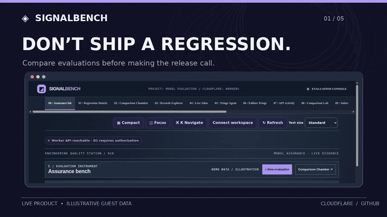
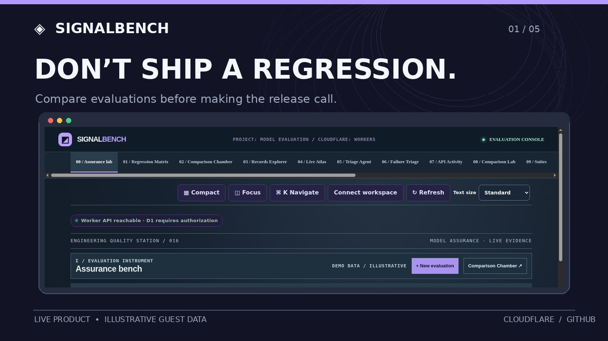
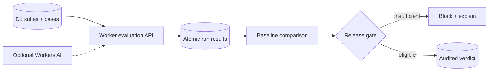

<div align="center">

# SignalBench

### Ship the model. Not the regression.

Evidence-first model evaluation and release gating.

[](https://github.com/amiddlebrook/SignalBench/actions/workflows/ci.yml) [](https://github.com/amiddlebrook/SignalBench/actions/workflows/deploy.yml) [](LICENSE) [](docs/ZERO_COST_POLICY.md)

**[Launch application](https://portfolio-signalbench.averymiddlebrook2014.workers.dev)** · **[Watch the 20-second demo](docs/media/brag.mp4)** · [Architecture](docs/ARCHITECTURE.md) · [Security](docs/SECURITY.md) · [Roadmap](docs/ROADMAP.md)

[](docs/media/brag.mp4)

*The demo uses real public Cloudflare UI captures with illustrative guest-mode records. The animation is a product tour, not evidence of paid AI execution.*

</div>

---

## The problem

The hardest part of evaluation chamber is not drawing a dashboard—it is making consequential decisions inspectable, recoverable and accountable.

**SignalBench** is an engineering platform for evidence-first model evaluation and release gating. Its primary audience is **ML engineers validating prompts, classifiers and AI releases**. Evaluate cases, compare baselines, and block promotions that lack evidence.

> [!IMPORTANT]
> **Production-deployed engineering portfolio project, not an audited enterprise SaaS.** The Worker, D1-backed API, access-control tests and deployment checks are operational. Single-workspace database ownership is enforced. This is **not** multitenant SSO, third-party security certification, a validated production D1 restore, or an unlimited-cost-free SLA.

## See it work

[](docs/media/brag.mp4)

**[▶ Watch full MP4](docs/media/brag.mp4)** · **[↗ Try the live guest demo](https://portfolio-signalbench.averymiddlebrook2014.workers.dev)** · [Storyboard and reproduction](docs/BRAG_DEMO.md)

SignalBench starts with an illustrative, read-only guest experience. **Authenticated operations require the administrator's API credential**; the README does not publish or distribute access keys.

### The end-to-end path

1. Define an evaluation target, suite and cases.
2. Start a run; freeze suite definitions for comparability.
3. Record each result transactionally with the evaluation cursor.
4. Compare with a pinned baseline; inspect regressions and uncertainty.
5. Preview a complete-evidence release decision before promotion.

## Engineering highlights

| Capability | Design decision |
|---|---|
| **Case-level observability** | Failure matrices expose which prompts and assertions regressed. |
| **Immutable comparisons** | Case definitions freeze once an evaluation is in progress. |
| **Release policy** | Minimum observations, pass rate, optional Wilson confidence lower bound. |
| **Atomic accounting** | No orphaned results or falsely advanced run cursors. |

## Architecture



**Frontend:** responsive JavaScript/CSS on Cloudflare Workers static assets.  
**API:** TypeScript Cloudflare Worker with validated, scoped endpoints.  
**Persistence:** a dedicated Cloudflare D1 database for this single-workspace application.  
**Automation:** GitHub Actions for tests, migration integrity, live Cloudflare deployment, authenticated smoke checks and Chromium browser verification.  
**AI inference:** optional Workers AI, disabled in production by default; budget enforced if deliberately enabled.

**The engineering emphasis:** Frozen case suites, transactional result cursor, baseline pinning, Wilson lower-bound gate and scoped delegated API credentials.

## Run your own instance

**Requirements:** Node.js 22+, npm, a GitHub account and a Cloudflare account with available Free-plan capacity.

```bash
git clone https://github.com/amiddlebrook/SignalBench.git
cd SignalBench
npm ci
npm run check
npm test
npm run db:local
npm run dev
```

Open the local URL printed by Wrangler. Local development uses a **local D1 instance**, not the live portfolio database. To deploy your own environment, create a unique D1 database, configure `wrangler.jsonc` to reference **your own account and database**, set a secret administrator token with `wrangler secret put ADMIN_TOKEN`, run `npm run db:remote`, then `npm run deploy`. **Never reuse the portfolio project's deployment target or publish secrets.**

Production deployments require the account's GitHub Actions repository secrets for Cloudflare authentication and the application administrator; see [`docs/OPERATIONS.md`](docs/OPERATIONS.md) and [`docs/SECURITY.md`](docs/SECURITY.md).

## Verification and operational controls

| Gate | Command or workflow | What it establishes |
|---|---|---|
| TypeScript and syntax | `npm run check` | Type soundness and frontend syntax |
| Domain and security tests | `npm test` | Isolated SQLite/D1-style integration and negative cases |
| Reproducible build | `npm run verify:release` | Locked dependencies, migration and asset integrity |
| Database restore drill | `npm run verify:recovery` | Synthetic schema/data backup→restore integrity |
| Scoped live credentials | `npm run verify:auth-live` | Production key creation, restriction and revocation |
| Live browser acceptance | `npm run verify:browser` | Cloudflare desktop/mobile guest and authenticated navigation |
| Edge latency sample | `npm run verify:edge` | 24 bounded read-only health requests; **not** a load SLA |

Every push to `main` triggers GitHub CI and Cloudflare deployment. Production-release checks include a dedicated Worker/D1 ownership fence, scoped credential lifecycle, free-tier budget policy, browser screens, and restoration rehearsal. [Inspect the deploy workflow](.github/workflows/deploy.yml).

## Zero-cost operating model

This repository uses **only free-tier-compatible Cloudflare and GitHub services** and adds application-level daily quotas. Remote AI is disabled by default. When a supported quota is exceeded, the operation is rejected rather than silently falling back to a paid service. Cloudflare's provider-side allocations are shared across the account where applicable; **unlimited use for $0 is not promised**. [Quota design and limitations](docs/ZERO_COST_POLICY.md).

## Security boundaries and trade-offs

- Each product has its own Worker, database binding and immutable runtime workspace ownership record.
- Private API routes require an administrator credential or appropriately scoped, expiring delegated key; credentials are never embedded in the frontend.
- Revocation, approvals and other security-critical transitions are guarded by atomic SQLite state changes and audited where implemented.
- The public guest experience displays **illustrative data**, not real customer information.
- **Out of scope today:** Evidence and release-policy demonstration; not third-party certification of model safety. Production restoration from real customer data and third-party penetration testing have not been demonstrated.

See the explicit [security model](docs/SECURITY.md), [architecture trade-offs](docs/ARCHITECTURE.md) and [production-readiness backlog](docs/ROADMAP.md).

## Repository map

```text
public/         Distinctive product interface, styles and static assets
src/            Cloudflare Worker, domain APIs, security and free-tier policy
migrations/     Versioned D1 schema and transactional safeguards
tests/          Domain regression, security and contract tests
scripts/        Release checks, browser verification and BRAG video renderer
.github/        CI, Cloudflare deployment and demo publication workflows
docs/           Architecture, operations, decisions, media and demos
```

## What's next

- [ ] Reproducible provider trace replay
- [ ] Signed CI release artifacts and gate CLI
- [ ] Variance-aware multiple-run evaluation

**License:** [MIT](LICENSE). **Demo method:** [BRAG-slim](https://github.com/latent-spaces/brag/tree/main/skills/brag-slim), using actual guest UI captures and a reproducible, no-paid-service video renderer. [Full video](docs/media/brag.mp4).
