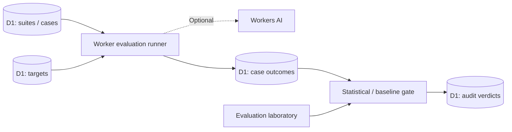

# SignalBench

> **Phase 12: Live Atlas** — A production-deployed, authenticated spatial intelligence view using only records from the existing Workers/D1 APIs, unique entity-specific graph layouts, inspector, keyboard controls, responsive pan/zoom, layer filtering, and privacy-conscious export. [Interaction architecture and limitations](docs/SPATIAL_ATLAS.md).

**LLM evaluation laboratory · policy-gated releases**  
*Promote models with evidence, not intuition.*

[](https://github.com/amiddlebrook/SignalBench/actions/workflows/ci.yml) [](https://github.com/amiddlebrook/SignalBench/actions/workflows/deploy.yml) [](LICENSE) 

**[Launch live application](https://portfolio-signalbench.averymiddlebrook2014.workers.dev)** · [Engineering architecture](docs/ARCHITECTURE.md) · [Security model](docs/SECURITY.md) · [Roadmap](docs/ROADMAP.md)

An AI reliability laboratory for defining evaluation suites, inspecting case-level outcomes, and recording release verdicts. SignalBench demonstrates **fail-closed evaluation policy**, baseline comparison and uncertainty-aware decisions—not self-certified model quality.

> **Project status — portfolio engineering application.** The interfaces, D1-backed APIs, tests, and automatic deployment are functional. This is **not** a certified or audited enterprise product, and there are no claims of SSO, multi-tenant isolation, unbounded free usage, or uptime SLAs.

## Decision workspace (Phase 8)

A dedicated operational decision screen is available under **Failure Triage**. This includes a real D1-backed API, validated writes and a product-specific interface; see [Decision workspace architecture](docs/DECISION_WORKSPACE.md).

## What makes it different

- **Evaluation suites.** Track targets, test cases and individual run results.
- **Release gate policy.** Minimum case counts, pass-rate thresholds, pinned baselines and regression checks.
- **Uncertainty handling.** Optional Wilson-score 95% lower-bound requirement; small samples cannot masquerade as high confidence.
- **Decision audit.** Persist blocked / allowed verdicts with supporting run metadata.
- **Evaluation-lab UI.** Cases, run history, scorecards and release gate configuration.

## System design



**Core stack:** Cloudflare Workers (TypeScript), Cloudflare D1 (SQLite), static Workers assets (vanilla JavaScript/CSS), optional Workers AI binding, GitHub Actions CI/CD. Workers AI inference is quota-bound and some workflows do not require AI at all.

**Critical domain path:** Define cases → execute suite → record per-case scores → compare baseline → apply statistical gate → persist verdict.

Wilson intervals model independent Bernoulli trials. Correlated, cherry-picked or contaminated test sets invalidate confidence claims. There is no universal grading system or full third-party provider coverage yet.

## Explore the live product

Open **[SignalBench](https://portfolio-signalbench.averymiddlebrook2014.workers.dev)**. Public visitors can inspect the branded, read-only product shell; actual database content and API operations require a credential. Each deployed application has **its own** D1 database, UI, API and release pipeline.

1. Create or load a labeled suite of test cases.
2. Configure a target and inspect the evaluation cases.
3. Execute a run and compare observed case outcomes.
4. Apply a release gate with a minimum sample size and confidence threshold.
5. Inspect the persisted verdict, including why a release was blocked.

The sample data is intentionally synthetic. UI counters reflect database records; screenshots, marketing claims and production-scale benchmarks are not fabricated.

## Run locally

**Requirements:** Node.js 22+, npm, and a Cloudflare account only if deploying. Git and Python 3.12 are useful for contributions; Python is required for this repository's Python tests when present.

```bash
git clone https://github.com/amiddlebrook/SignalBench.git
cd SignalBench
npm install
npm run check
npm test
npm run db:local
npm run dev
```

Open the local URL Wrangler prints. Local `localhost` development bypasses deployed bearer authentication so sample workflows are easy to exercise; **never treat that convenience as a deployment authentication configuration**. D1 migrations run locally before the first start.

For Cloudflare deployment, the production pipeline creates/reuses its own D1 database, applies migrations and updates the Worker. `wrangler.jsonc` contains a placeholder database ID that the pipeline resolves at runtime; do not commit your credentials or a machine-specific live database ID.

## API tour

`GET /api/health` is the only intentionally unauthenticated API route on the public deployment. All routes below require a bearer credential.

| Method | Endpoint | Purpose |
|---|---|---|
| `GET` | `/api/suites` | Suites |
| `GET` | `/api/targets` | Model targets |
| `GET` | `/api/runs` | Evaluation runs |
| `GET` | `/api/gates` | Gate policy |
| `GET` | `/api/verdicts` | Release verdicts |
| `GET` | `/api/cases` | Case catalog |

Example, using a root token already configured as the private Cloudflare `ADMIN_TOKEN`:

```bash
# Set this in your shell without checking it into source control:
export APP_ADMIN_TOKEN='YOUR_PRIVATE_TOKEN'
curl -sS 'https://portfolio-signalbench.averymiddlebrook2014.workers.dev/api/overview' \
  -H "Authorization: Bearer $APP_ADMIN_TOKEN"
```

### Scoped API access (current milestone)

The root administrator can mint time-limited **viewer** or **operator** credentials from **Access control**, or with `POST /api/access/keys` (admin only). The response returns the new secret **exactly once**. Only its SHA-256 digest is stored in D1.

```json
{
  "label": "Portfolio read-only integration",
  "role": "viewer",
  "route_prefix": "/api/",
  "expires_in_days": 7
}
```

- `viewer`: `GET` / `HEAD`; cannot mutate state.
- `operator`: permitted methods excluding `DELETE`; can be restricted to an API prefix.
- `admin`: the root Worker secret, not a stored database key; only it can issue/revoke keys or inspect credential audit.
- Scoped credentials expire after 1–90 days, can be revoked immediately, and record last use. Endpoint permissions apply to API calls; **they are not tenant isolation or an SSO/RBAC system**.

Keep credentials in a secret manager. Do **not** include them in URLs, source code, issues, screenshots, or documentation. Browser credentials in this demo use tab-lifetime `sessionStorage` and should be considered sensitive.

## Delivery and verification

The two workflows under `.github/workflows/` are separate:

1. **`ci.yml`** checks TypeScript, browser JavaScript, SQL-backed integration tests, and security contracts on pull requests / pushes.
2. **`deploy.yml`** runs checks on `main`, resolves and migrates the correct D1 instance, deploys static assets + Worker, installs `ADMIN_TOKEN` via Wrangler secret storage, and smoke-tests live authenticated/unauthenticated APIs.

Required GitHub Actions secrets: `CLOUDFLARE_ACCOUNT_ID`, `CLOUDFLARE_API_TOKEN`, and `APP_ADMIN_TOKEN`. The Cloudflare token requires permissions to edit Workers and D1 on the target account. See [Security](docs/SECURITY.md) for credential lifecycle and limitations.

Useful commands:

```bash
npm run check       # TypeScript + frontend syntax
npm test            # Application and security tests; Python tests when present
npm run db:local    # Apply local D1 migrations
npm run verify:live # Requires DEPLOY_URL and APP_ADMIN_TOKEN environment variables
```

GitHub workflow badges show the latest GitHub Actions status, **not** independent penetration testing or SLO certification. Free-tier quotas and provider availability apply. Deployment does not automatically upgrade billing.

## Security and known limitations

Implemented: deployment-time root secret, scoped expiring API keys, revocation/audit, parameterized SQLite access, defensive input checks, and fail-closed authorization for protected routes. The root credential and all data exist within **one account workspace**.

**Not yet implemented:** Semantic / judge-model grading calibration, replayable adversarial datasets, signed CI artifacts, drift dashboards, multi-provider runners and independent benchmark review.

The published [production-readiness backlog](docs/ROADMAP.md) tracks the remaining work; read [SECURITY.md](docs/SECURITY.md) for a candid threat model. CI coverage is meaningful engineering evidence, but this project should not be presented as SOC 2 certified, penetration-tested, or production-ready for sensitive multi-customer data.

## Development contributions

Issue reports, reproducible failure cases, test fixtures and targeted pull requests are welcome. Prefer changes that include tests for concurrency, authorization, unexpected input, and migration safety. Keep mock inference clearly labeled, never commit tokens or real customer datasets, and document important tradeoffs in `docs/ARCHITECTURE.md`.

**License:** [MIT](LICENSE).

## Distinct application interface

This repository uses its own workspace layout and record presentation, not the standard UI shell from the other portfolio apps. See [the design-system specification](docs/DESIGN_SYSTEM.md) for the interaction model, security/privacy considerations, and remaining verification work.

## Domain studio (Phase 7)

The protected **Comparison Lab** workspace is a purpose-built analytical interface powered by a bounded D1 read endpoint: `GET /api/studio/run-comparison`. It requires an authorized root or scoped key and never invents observations. The studio is read-only by design; mutations remain in the primary workflow screens. Navigate to **Comparison Lab** after authenticating. Each CI release asserts the studio API and static assets are actually served by the deployed Worker. This dashboard is not a substitute for complete enterprise identity, load testing, or independent security assessment.

## Domain workbench & operational diagnostics (Phase 7)

- **Specialized workbench:** live database-backed `SignalBench` workspace available from the main application navigation. It can export a single selected workflow/source/comparison/trace/lineage artifact, explicitly labeled with sampling and evidence limitations. Source: `src/studio.ts`, `public/studio.js`, `public/studio.css`.
- **Administrative API Activity:** protected mutation journal with correlation IDs (`X-Request-ID`), actor role, HTTP outcome, and latency. Admin-only `GET /api/ops/activity` and `GET /api/ops/summary`; migration `0005_operations.sql`. Activity exports are scoped to the loaded page and do not contain credentials or request bodies. More detail: [Operational diagnostics](docs/OPERATIONS.md).
- **Verification:** SQL-backed studio tests, authorization/redaction tests, regression tests for exported report structure, TypeScript checks, and GitHub Actions live HTTP checks of both workbenches.

This release is **not** multi-tenant or SSO-ready; write telemetry is best effort, and advanced distributed workflows remain outside the current production scope. See [Roadmap](docs/ROADMAP.md).

## Agent runtime

The **Agent** workspace provides a bounded Workers AI + D1 read-only tool-use loop, domain-specific tool allowlists, operator-stepped execution, and auditable traces. See [Agent Runtime](docs/AGENTS.md) for the lifecycle, trust boundaries, and limitations.

## Agent evidence dossiers and human review

The bounded, read-only Workers AI agent provides `GET /api/agents/:id/dossier` (ordered trace, data snapshot, SHA-256 fingerprint) and an immutable human review at `POST /api/agents/:id/review`. Reviews require a root-admin credential and an explicit written justification. An **accepted** review confirms a human evaluated the report; it never authorizes a workflow, evidence, deployment, production route or model promotion. These fingerprints do not independently prove source authenticity, and review records are not a compliance-grade audit. The agent interface renders the trace in a product-specific workspace and supports a local JSON evidence download.

### Phase 10 · Personal perspectives

D1-backed, credential-isolated saved views are available from each authenticated record explorer, with keyboard-friendly controls, section-specific presets, scoped deep links, and focus/density modes. See [`docs/SAVED_VIEWS.md`](docs/SAVED_VIEWS.md).

## Phase 11: Interactive record workbench (October 2026)

All authenticated record sections now support three layouts (cards, data grid, timeline), real loaded-record state distributions, facet filtering, twelve-item pagination, multi-record comparison, protected CSV/JSON exports, and a modal inspector. Distinct domain visual systems remain intact. See [Record workbench design and security](docs/RECORD_WORKBENCH.md). Client-side list navigation operates only on rows returned by the existing API; full server cursor pagination is future work.

## Phase 11: Interactive record workbench (October 2026)

All authenticated record sections now support three layouts (cards, data grid, timeline), real loaded-record state distributions, facet filtering, twelve-item pagination, multi-record comparison, protected CSV/JSON exports, and a modal inspector. Distinct domain visual systems remain intact. See [Record workbench design and security](docs/RECORD_WORKBENCH.md). Client-side list navigation operates only on rows returned by the existing API; full server cursor pagination is future work.
